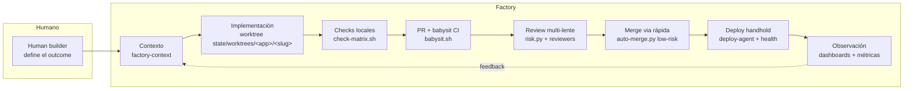
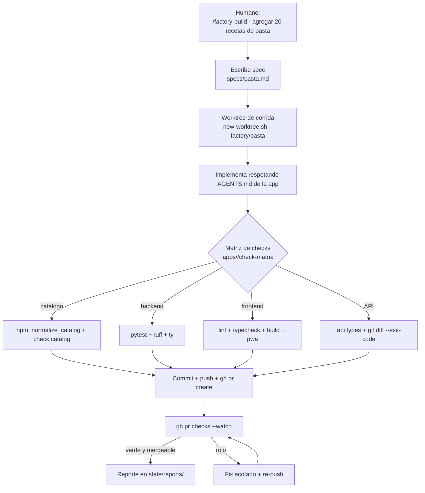
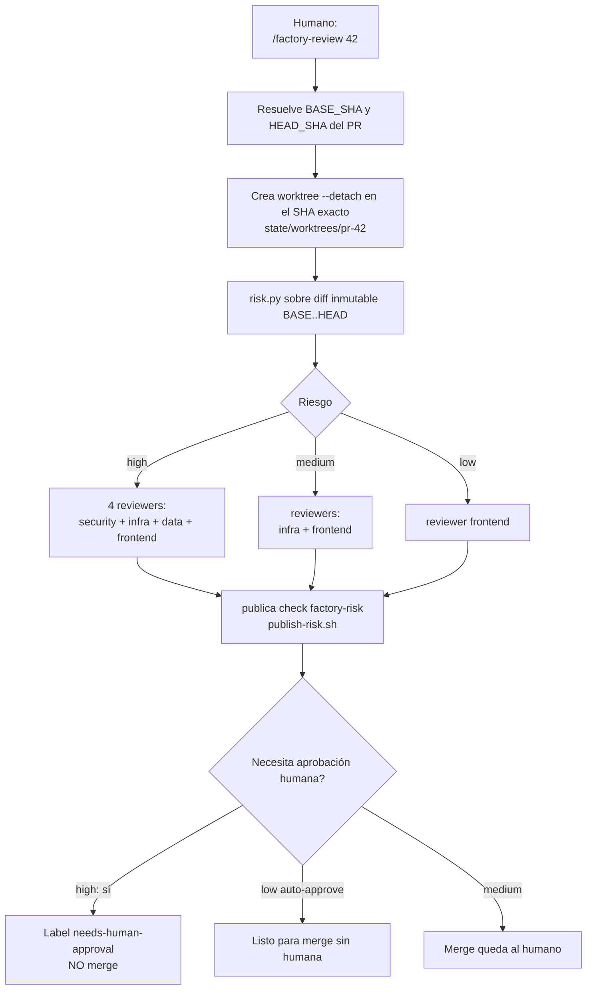
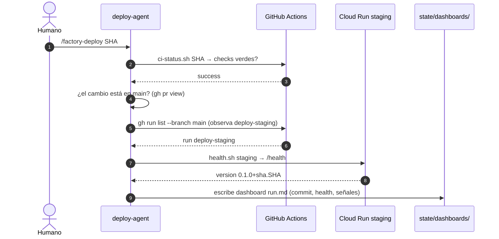
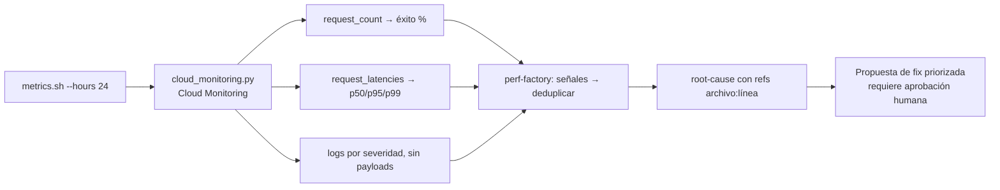
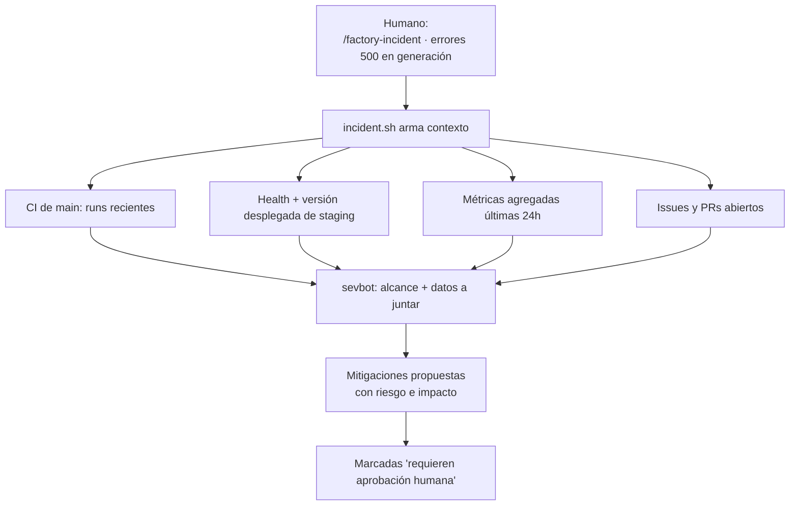
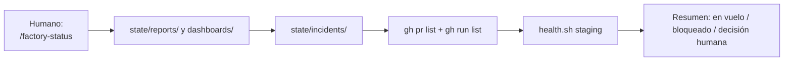

# Harness Mi Mesa — Software Factory

Un **control tower** de agentes (opencode) que orquesta el desarrollo de la
app [mi-mesa-recetario](https://github.com/iariap/mi-mesa-recetario) siguiendo
los lineamientos del
[OpenAI Software Factory](https://newsletter.pragmaticengineer.com/p/openai-software-factory)
— el pipeline agentic de OpenAI donde un cambio viaja de una **spec humana**
hasta **producción observada** con agentes en cada etapa.

> Este repo **no contiene el código de la app**. Es la "fábrica": define el
> pipeline, la política de riesgo, los revisores especialistas y el estado de
> cada corrida. La fuente de verdad sigue siendo `iariap/mi-mesa-recetario`.

---

## Índice

1. [¿Qué es?](#qué-es)
2. [Los 9 flujos del factory](#los-9-flujos-del-factory)
3. [Flujos de trabajo día a día](#flujos-de-trabajo-día-a-día)
   - [Flujo A · Construir un cambio](#flujo-a--construir-un-cambio)
   - [Flujo B · Revisar un PR](#flujo-b--revisar-un-pr)
   - [Flujo C · Desplegar](#flujo-c--desplegar)
   - [Flujo D · Perf factory](#flujo-d--perf-factory)
   - [Flujo E · Responder un incidente](#flujo-e--responder-un-incidente)
   - [Flujo F · Estado del factory](#flujo-f--estado-del-factory)
4. [Política de riesgo](#política-de-riesgo)
5. [Estructura del repo](#estructura-del-repo)
6. [Primeros pasos](#primeros-pasos)
7. [Usar ASF desde pi.dev](#usar-asf-desde-pidev)
8. [Invariantes](#invariantes)
9. [Cómo se verifica el harness](#cómo-se-verifica-el-harness)

---

## ¿Qué es?

En el modelo de OpenAI, la "software factory" convierte un **outcome deseado**
(en palabras de un humano) en código **revisado, desplegado y observado**,
minimizando el cuello de botella humano y dejando la **aprobación** donde la
responsabilidad lo exige.

Este harness traduce ese modelo a opencode:



El círculo se cierra: **producción observada** alimenta al `perf-factory`
(regresiones) y al `sevbot` (incidentes), que vuelven al contexto de la
próxima corrida.

## Los 9 flujos del factory

Cada etapa del artículo de Pragmatic Engineer tiene un componente operable:

| # | Etapa del factory | Componente en `asf/` | Comando |
|---|---|---|---|
| 1 | Human builder define el outcome | `specs/<id>.md` | `/factory-build` |
| 2 | Agente junta contexto | skill `factory-context` + `references` + `work/` (checkout base) | — |
| 3 | Implementación | worktree por corrida `state/worktrees/<app>/<slug>` (`new-worktree.sh`) | `/factory-build` |
| 4 | Build/test + CI | `scripts/apps/<app>/check-matrix.sh` + `babysit.sh` | `/factory-build` |
| 5 | Review agentica multi-lente + riesgo | `config/policies/` + reviewers por dominio | `/factory-review` |
| 5b | Merge low-risk (vía rápida) | `auto-merge.py` (shadow → enabled, auto-revert post-deploy) | `/factory-merge` |
| 6 | Deploy agentic (handhold) | `deploy-agent` + `health.sh` | `/factory-deploy` |
| 7 | Observar producción | dashboards por cambio en `state/dashboards/` | `/factory-deploy` |
| 8 | Perf factory | `perf-factory` + `cloud_monitoring.py` | `/factory-perf` |
| 9 | Sevbot | `sevbot` + `incident.sh` | `/factory-incident` |

---

## Flujos de trabajo día a día

### Flujo A · Construir un cambio

El punto de entrada. Un humano describe **qué quiere y por qué**; el factory se
encarga del **cómo**.



Reglas que se aplican solas:

- **Anti-loop**: si un check falla con la misma salida dos veces, `babysit.sh`
  rechaza el reintento (mismo head SHA + mismo exit): hay que **cambiar algo**
  (un fix, integrar main) antes de volver.
- **Catálogo = invariante**: si cambia `backend/src/omavu/data/**`, la matriz
  exige `normalize_catalog.py` y `check:catalog`; no se pueden saltar.
- El harness **nunca mergea ni pushea a `main`** sin aprobación.

### Flujo B · Revisar un PR

La review agentica con **lentes por dominio**, como la de OpenAI pero a escala
personal. El diff se clasifica por riesgo y cada reviewer mira solo su dominio.



- Los reviewers tienen `bash: deny`: solo usan herramientas de lectura y el
  diff que les pasa el orquestador. **No pueden editar.**
- El nivel de riesgo lo calcula `risk.py` sobre el diff **inmutable**
  `BASE..HEAD`; nunca se recibe "a mano".
- Para que el check `factory-risk` bloquee el merge de verdad, hay que
  configurar **branch protection** en el repo de la app exigiendo ese check.

### Flujo C · Desplegar

El `deploy-agent` **handhold**: verifica CI verde, observa el deploy automático
de staging (push a `main`), chequea `/health` y deja un dashboard.



- El `deploy-agent` **edita solo `state/dashboards/**`**: no toca el código.
- No dispara deploys manuales: **observa** el deploy automático de main.
- **Producción siempre requiere aprobación humana** explícita.

### Flujo D · Perf factory

Convierte métricas de producción en hipótesis accionables. No aplica fixes:
propone.



**Privacidad (PHI)**: `cloud_monitoring.py` solo emite **agregados**
(conteos, percentiles, severidad). Nunca vuelca el contenido de un log. Si no
hay acceso real (GCP/Logfire), el resultado es `PENDIENTE` explícito — nunca
datos inventados.

### Flujo E · Responder un incidente

El `sevbot` **junta contexto y propone mitigaciones; nunca ejecuta**.



### Flujo F · Estado del factory



---

## Política de riesgo

La policy mergeada (`config/policies/base.json` + `config/policies/<app>.json`) decide, por **archivo** cambiado:

| Nivel | Aprobar | Reviewers | Ejemplos de paths |
|---|---|---|---|
| `high` | **Humana obligatoria** | security + infra + data + frontend | `data/**`, `api.py`, `domain.py`, `extraction.py`, `observability.py`, `tracing.py`, `catalog.py`, `nutrition.py`, `services.py`, `supabase/migrations/**`, `deploy/**`, `.github/workflows/**`, `PHI.md` |
| `medium` | Revisión agentica; merge humano | infra + frontend | `review.py`, `config.py`, `model_settings.py`, `pantry_agent.py`, `backend/uv.lock`, `Dockerfile`, archivos sin regla |
| `low` | Auto-approve | frontend | `frontend/**`, `evals/**`, `docs/**` |

Reglas del clasificador (`scripts/risk.py`):

- Cada archivo se clasifica **individualmente**: la regla más alta que matchea,
  o el `default_risk` (`medium`) si no matchea ninguna.
- El nivel final es el **máximo** entre archivos.
- Los **reviewers son la unión** de los reviewers de todas las reglas que
  matchean (un diff `frontend + catálogo` dispara los 4 reviewers).

---

## Estructura del repo

```text
asf/
├── opencode.json                 # config de opencode (references, permisos)
├── AGENTS.md                     # invariantes del harness para agentes
├── PLAN.md                       # diseño y mapeo de las 9 etapas
├── .opencode/
│   ├── command/                  # /factory-build · /factory-review · /factory-merge · /factory-deploy
│   │                             # /factory-perf · /factory-incident · /factory-sec · /factory-status
│   │                             # /factory-resume · /factory-interrogate · /factory-correct
│   ├── skill/
│   │   ├── factory-context/      # junta el contexto real de mi-mesa
│   │   ├── factory-ci/           # matriz de checks + PR + babysit
│   │   ├── factory-report/       # reporte reproducible por corrida
│   │   └── security-audit/       # metodología de auditoría (6 fases, grounded)
│   └── agent/
│       ├── reviewer-security.md  # PHI, secretos, auth
│       ├── security-guardian.md  # auditoría defensiva del checkout (grounded)
│       ├── reviewer-infra.md     # Cloud Run, costos, escalado
│       ├── reviewer-frontend.md  # React/TS, UX, PWA
│       ├── reviewer-data.md      # catálogo, nutrientes, doshas
│       ├── deploy-agent.md       # handhold staging + health + dashboard
│       ├── perf-factory.md       # regresiones → propuesta de fix (números veteados)
│       ├── interrogator.md       # panel adversarial: intenta romper el diff
│       └── sevbot.md             # incidentes: contexto + mitigaciones
├── .pi/                          # entrada pi.dev (aditiva; fuente de verdad: .opencode/)
│   ├── settings.json             # pi-subagents pinneado + subagents DeepSeek + modelScope
│   ├── agents/*.md               # wrappers compactos que referencian .opencode/agent/*.md
│   └── extensions/asf-subagents.ts  # guard de scope/cwd/tools en tool_call + contrato
├── config/
│   ├── apps/<id>.json            # puntero mínimo: repo, remote, checkout
│   └── policies/base.json        # reglas comunes no negables (+ <app>.json fallback)
├── scripts/
│   ├── app_config.py             # resolvedor del registry (--list/--sh/merged_policy)
│   ├── sync-work.sh <app>        # clona/actualiza el checkout base work/<app>
│   ├── new-worktree.sh <app> <slug> [base] # worktree por corrida
│   ├── risk.py <app>             # clasificador por archivo (unión de reviewers)
│   ├── auto-merge.py <app>       # vía rápida low-risk fall-closed (shadow default)
│   ├── cleanup.sh <app> [--apply] # limpia worktrees stale de build y review (shadow default)
│   ├── trace-report.py <app> <slug> # traza OTel-style: rendimiento por agente + diagrama + waterfall (HTML único)
│   ├── run-stats.py [app|--all]   # métricas cross-corrida de state/reports (dos layouts, sin red/gh)
│   ├── agent-stats.py [--days N]  # agentes/skills desde opencode.db (read-only, sólo agregados)
│   ├── wait_until.sh <t> <iv> --  # espera hasta-condición con techo (pipe-friendly)
│   ├── babysit.sh <app>          # babysitter determinista (timeout, SHA, anti-loop)
│   ├── publish-risk.sh <app>     # check 'factory-risk' en GitHub (Checks API)
│   ├── ci-status.sh <app>        # estado de CI de PR/commit/rama
│   ├── health.sh <app>           # health de entornos del registry
│   ├── metrics.sh <app>          # wrapper de cloud_monitoring
│   ├── cloud_monitoring.py       # agregados Cloud Monitoring (p50/p95/p99, éxito)
│   ├── incident.sh <app>         # contexto de incidente para sevbot
│   ├── apps/<app>/               # helpers por app (check-matrix, imágenes)
│   └── test_harness.py           # tests del harness (unittest, sin deps)
├── work/                         # checkout base por app (nunca se implementa acá; gitignored)
├── specs/                        # specs del human builder
└── state/                        # reports/ (run.json, decisions.tsv, report.md, trace.html), dashboards/, incidents/, worktrees/ (gitignored)
```

---

## Primeros pasos

1. **Clonar / abrir el harness** (este repo). Requisitos: `gh` autenticado,
   `uv`, `python3`, y opencode. `uv sync` instala las dev deps (ruff + ty).
2. **Ver apps del registry y sync del checkout**:
   ```bash
   python3 scripts/app_config.py --list       # apps configuradas
   scripts/sync-work.sh mi-mesa               # clona/actualiza el checkout base work/<app>
   scripts/new-worktree.sh mi-mesa <slug>     # worktree por implementación (factory/<slug>)
   ```
   Para sumar una app: `config/apps/<id>.json` (puntero mínimo) +
   `.factory/app.json` y `.factory/policy.json` **en el repo de la app** (fuente
   de verdad de su metadata: aliases, entornos, métricas, checks, reglas de
   riesgo). El resuelven `scripts/app_config.py` tras `sync-work.sh <app>`;
   `aliases` permite ids alternativos (`mi-receta` → `mi-mesa`, `harness` →
   `asf`). En CI con clone fresco (sin checkouts), los tests que dependen de la
   metadata de una app se saltan en vez de fallar.
3. **Reiniciar opencode** en `asf/` para que cargue los permisos y el skill
   `factory-context`.
4. **Probar clasificadores y tests del harness**:
   ```bash
   python3 scripts/risk.py - --self-test           # policy base
   python3 scripts/risk.py mi-mesa --self-test     # policy mergeada
   python3 scripts/auto-merge.py --self-test       # gates de vía rápida
   python3 scripts/test_harness.py                 # suite completa
   uv run ruff check scripts/ && uv run ty check scripts/
   ```
5. **Primer cambio**: `/factory-build mi-mesa "tu spec"` → seguí el flujo A.

> Para que el check `factory-risk` bloquee merges en el repo de la app, creá
> en GitHub un **branch protection rule** sobre `main` que requiera ese check,
> y proveé un `GITHUB_TOKEN` con permiso `checks:write` para `publish-risk.sh`.

---

## Usar ASF desde pi.dev

El harness también se maneja desde [pi.dev](https://pi.dev). La config vive en
`.pi/` y es **aditiva**: la fuente de verdad de los flujos sigue siendo
`.opencode/`.

### Prerrequisitos

- **pi 1.1.0 o 1.2.0** (versiones verificadas por la suite guard) y el paquete
  **`pi-subagents@0.66.0`**. `.pi/settings.json` lo
  declara como package de proyecto (`npm:pi-subagents@0.66.0`): pi lo instala en
  `.pi/npm/` al arrancar (identidad por nombre de package; si ya está global,
  la entrada de proyecto gana y no se carga dos veces).
- **Autenticación OpenRouter**: los subagents corren con
  `openrouter/deepseek/deepseek-v4.1-flash` (el `coder`, con fallback
  automático a `openrouter/deepseek/deepseek-v4.1-flash-1017` ante
  rate-limit). Autenticá OpenRouter en modo interactivo con `/login openrouter`
  (o exportá `OPENROUTER_API_KEY`) antes de delegar.
- **Trust del proyecto**: `.pi/settings.json` es config de proyecto; pi pide
  confiar en la carpeta la primera vez. Sin trust, pi ignora `.pi/settings.json`
  y no cargan los subagents ASF ni la extensión guard.

### Arrancar

1. **Iniciá pi desde la raíz de ASF** (el directorio con `manifest.json`), no
   desde la carpeta de la app. Desde ahí corré pi sin slash commands: le pedís
   el trabajo en lenguaje natural y el orquestador decide el flujo.
2. **Reiniciá / recargá** después de editar `.pi/settings.json` o
   `.pi/agents/*.md`: pi no re-lee settings ni agentes en cada turno (usá
   `/reload`, o reiniciá la sesión).
3. **No asumas snapshots automáticos**: abrir la carpeta de una app de forma
   independiente **no** carga el harness ni sus subagents. El harness se carga
   arrancando pi desde ASF; para trabajar sobre una app, el orquestador pasa
   `cwd` al checkout/worktree del child.

### Delegación (equivalencia OpenCode ↔ Pi)

En pi-subagents 0.66.0 la ejecución nativa es **code-driven por
`workflowScript`** (`runs.run`/`runs.all`); el `agent` top-level es target de
management. ASF permite **una sola plantilla verificable** y bloquea el resto:

```js
subagent({
  workflowScript: 'return runs.run("asf", { "agent": "coder", "task": "<encargo>", "cwd": "<abs>" })',
  cwd: "<abs>", agentScope: "both"
})
```

| | OpenCode | pi.dev |
|---|---|---|
| Herramienta | `task` | `subagent({ workflowScript: 'return runs.run(...)' })` |
| Implementación | `task` → subagent `coder` | `runs.run("asf", { "agent": "coder", "task": ... })` |
| Modelo subagents | `opencode/deepseek-v4.1-flash` fijo | `openrouter/deepseek/deepseek-v4.1-flash` fijo |
| Modelo orquestador | config default de opencode | libre (NO pinneado en `.pi/settings.json`) |
| Scope | — | `agentScope: "user" \| "project" \| "both"` (default `both`; project gana ante colisión) |

El child sólo acepta `agent` (rol ASF), `task`, `cwd`, `agentScope`
(`both`/`project`), `context` (`fresh`) y `model` (sólo el pin). El parser es
prefijo/sufijo + `JSON.parse` (sin `eval`), así que cualquier JS no literal se
rechaza. `cwd` (outer y child) **debe quedar dentro de la raíz del harness**
(los checkouts de app en `work/` y `state/worktrees/` lo están): así el child
resuelve `.pi/settings.json` y el `modelScope` estricto. Un `cwd` externo, un
`agentScope: "user"`, `workflowScriptPath`/`workflow`, top-level `agent`/`task`
o `resume` los **bloquea** la extensión `.pi/extensions/asf-subagents.ts`
(fail-closed). Para paralelismo, varias llamadas `subagent` foreground (no se
habilitó `runs.all`). La implementación sigue siendo **obligatoria vía
`coder`**: el orquestador coordina, inspecciona el diff, verifica checks y
gestiona Git/PR/CI.

### Roles y herramientas

- `.pi/agents/*.md` son **wrappers compactos**: declaran `name`, `description`,
  `model` y `tools`, y su cuerpo manda a leer el prompt canónico
  `.opencode/agent/<nombre>.md` (no copia el cuerpo). No sirve escanear
  `.opencode/agent/` con `agentScanDirs`: esos archivos no tienen `name`
  (pi-subagents los descarta en silencio), su `model` es un id de OpenCode y su
  `permission` no es el schema de Pi. pi-subagents además **no** mapea el
  `permission` YAML de OpenCode a una allowlist: por eso los tools van
  explícitos en el wrapper.
- Reviewers y analistas (`interrogator`, `perf-factory`, `reviewer-*`,
  `security-guardian`, `sevbot`) son **read-only**: `read, grep, find, ls`.
- `coder` es el único con `read, write, edit, bash`.
- `security-guardian` y `sevbot` **no tienen `bash`**: no ejecutan scans. El
  orquestador corre `security-audit`/`scripts/incident.sh` y les pasa la
  evidencia (auditoría ≠ ejecución).
- `deploy-agent` escribe sólo `state/dashboards/**`; pi no tiene sandbox de
  escritura por ruta, así que ese alcance se cumple **por instrucción** y por
  el prompt canónico.
- **Modos bloqueados por tools faltantes**: `researcher` necesita
  [`pi-web-access`](https://github.com/nicobailon/pi-web-access)
  (`pi install npm:pi-web-access`); sin él, el run falla con diagnóstico. Los
  roles read-only no pueden ejecutar comandos por diseño.
- **Runners externos deshabilitados**: `claude-code`, `codex-exec` y
  `cursor-agent` (y sus variantes `-writer`) no pasan por `modelScope` nativo,
  así que se deshabilitan con `disabled: true` en `.pi/settings.json`.
- **Extensión guard** (`.pi/extensions/asf-subagents.ts`): en cada
  `tool_call` de `subagent` autoriza sólo la plantilla `runs.run` con child
  allowlisted, y rechaza `agentScope: "user"`, `cwd` fuera del harness,
  `workflowScriptPath`/`workflow`, top-level `agent`/`task`/`model`, `resume`,
  `tools`, `extensions` y cualquier JS no literal. El management queda en
  allowlist read-only/control (`status`, `list`, `get`, `models`, `guide`,
  `doctor`, `children.list`, `stop`, `interrupt`, `steer`, `validate`); se
  bloquean `resume`, `create`, `update`, `eject`, `enable`, `schedule.*`,
  `project.*`, etc. En `before_agent_start` inyecta el formato exacto y en
  `session_start` publica el status `asf-subagents-guard` (prueba de carga).
  Frontera: si el proyecto no está trusted, Pi no carga la extensión.

### Política de modelo

`.pi/settings.json` fija `subagents.defaultModel` y `agentOverrides` de todos
los roles a `openrouter/deepseek/deepseek-v4.1-flash` (en OpenRouter no hay
DeepSeek free: es el más barato de la familia), con `modelScope`
`enforce: true`, `strict: true` y `allow` con ese id más el fallback del
`coder` (`openrouter/deepseek/deepseek-v4.1-flash-1017`; sin `inherit`). El
`coder` declara `fallbackModels: ["openrouter/deepseek/deepseek-v4.1-flash-1017"]`:
ante rate-limit cae solo a DeepSeek V4.1 Flash 1017 (non-free); los demás
roles siguen con `fallbackModels: []`. Cualquier intento de correr un subagent
con otro modelo —incluido un override por corrida— **falla antes de
arrancar**. El modelo del orquestador no se toca: queda a cargo de la config
de pi del usuario.

### Compartir skills

`.pi/settings.json` expone `"skills": ["../.opencode/skill"]` (relativo a
`.pi/`, o sea `<raíz>/.opencode/skill`), así que los subagents con
`inheritSkills: true` ven el catálogo de skills del harness (`factory-*`,
`security-audit`, `wait-for`, ...).

### Verificar la config sin gastar tokens

`bun scripts/pi-discover.ts "$(git rev-parse --show-toplevel)"` corre el
descubrimiento real de pi-subagents (package de proyecto `.pi/npm` primero,
global después) y **sale con exit != 0** si el package no está en la versión
pinneada, si falta o cambia un subagent ASF (tools/modelo/fallback), si
`modelScope` no es estricto con el pin y el fallback del coder, si un runner
externo sigue habilitado o si un modelo caro/local no es rechazado. No lee auth
ni imprime credenciales.

`bun test scripts/pi-extension.test.ts` prueba los hooks de la extensión guard
con un mock de `ExtensionAPI` (sin llamadas de modelo) y valida la plantilla
`coder` con el `validateWorkflowScript` REAL del paquete. El smoke de arranque
es:

```bash
printf '{"type":"get_state"}\n' | pi --offline --approve --no-session --mode rpc
```

Pi arranca offline (sin llamadas LLM ni auth), monta la extensión (emite el
status `asf-subagents-guard`) y responde `get_state`. La suite
`python3 scripts/test_harness.py` corre todo lo anterior si `bun`/`pi` están
disponibles y cubre la config de forma determinista
(`TestPiDelegationConfig`, `TestPiExtensionHooks`).

---

## Invariantes

No romper, aunque el harness "pueda":

- El repo de cada app es la **fuente de verdad**: `work/<app>` es el checkout
  base, descartable, y se regenera con `sync-work.sh <app>`. La implementación
  va en el **worktree de la corrida** `state/worktrees/<app>/<slug>` (rama
  `factory/<slug>`, vía `scripts/new-worktree.sh`); una sola tarea escritora
  por worktree; `cleanup.sh` recolecta los stale post-merge.
- **El orquestador SOLO orquesta**: contexto, spec, coordinación, inspección de
  diffs, checks deterministas y Git/PR/CI; toda producción de artefactos
  (código, tests, docs, fixes — del harness y de las apps) se delega a
  subagents con `task`. Nunca edita archivos directamente. Sin `task`/`coder`
  disponible: PENDIENTE, sin fallback de modelo.
- Respetar las invariantes del `AGENTS.md` de la app objetivo (en mi-mesa: un
  solo servicio Cloud Run, sin Cloud Tasks/Redis, gates deterministas siempre
  activos, telemetría sin contenido, secretos solo en Secret Manager).
- **Aprobación humana obligatoria** para riesgo alto/medio: el agente propone,
  nunca mergea ni deploya solo. La única excepción es la vía rápida
  (`scripts/auto-merge.py`, fall-closed, shadow por default).
- Nunca ejecutar acciones destructivas o pagas sin pedirlas: no hay
  `deploy.sh production` implícito ni borrado de datos.
- `state/` y `work/` no se committean; los specs y políticas sí.
- Un subagent reviewer **nunca edita**: solo revisa y reporta.
- `sevbot` y `perf-factory` **diagnostican y proponen**, nunca aplican fixes.
- Los scripts shell usan `set -euo pipefail`; el python usa stdlib sin deps.

## Cómo se verifica el harness

El harness es software y se prueba:

```bash
python3 scripts/test_harness.py
```

Cubre: clasificación de riesgo con **casos literales** (no derivados del
algoritmo), anti-loop de `babysit.sh` con un `gh` falso, exigencia de token de
`publish-risk.sh`, y `cloud_monitoring.py` con un `gcloud` falso (agregados sin
payloads). Corrélo antes de commitear cambios en `scripts/` o `config/`.